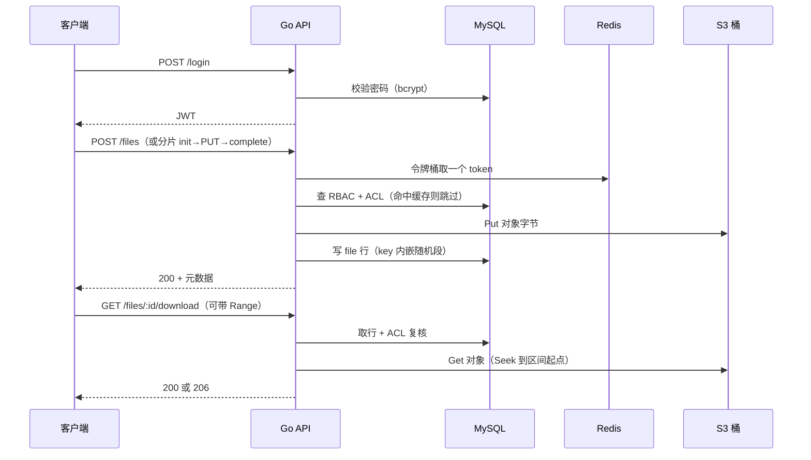

# Go-DocHub


多租户文件安全分发与权限协作系统：分片断点续传、SHA256 秒传、角色与目录两层权限、租户级限流，字节落在 S3 兼容对象存储。


## 项目预览

```
$ bash scripts/demo-chunked-upload.sh
== login ==
== init (1048576 bytes, sha 48bd31db…) ==
{"code":0,...,"upload_id":15,"chunk_size":1048576,"chunk_count":1}
== upload every chunk except the first, then resume ==
== status after the simulated interruption ==
{"code":0,...,"done":false,"missing":[0],...}
== send only the missing chunk 0 ==
{"code":0,...,"index":0,"size":1048576,...}
== merge ==
{"code":0,...,"id":171,"size":1048576,"storage":"s3"}
== download and compare ==
original: 48bd31db72d5416cd8c35e543df19b4cfaa59f8984c442191b399cfd2ef287a9
returned: 48bd31db72d5416cd8c35e543df19b4cfaa59f8984c442191b399cfd2ef287a9
OK: byte identical
```

中断后只补缺失的分片，合并结果与源文件逐字节一致。

## 核心功能

### 一、分片断点续传与秒传

> 大文件不被一次请求绑住，弱网重连也不从头再来。

- `POST /uploads` 返回 uploadID、分片大小与片数；每片带独立的 SHA256，服务端边收边算，对不上就丢弃该片且不记录。
- 中断后 `GET /uploads/:id` 返回 `missing`，客户端只补缺的那几片。分片可以乱序到达：落地文件名带编号，合并时按编号算偏移直接写，到达顺序无关。
- 合并前先查缺片，缺一片就返回 409，不会合并出半个文件；合并时逐片再校验一次（临时文件在磁盘上，从收片到合并之间可能被替换），校验与写盘同一趟完成。
- 秒传：客户端先给整个文件的 SHA256，命中同租户已有对象就只追加一行引用，零传输零写入。
- 上传状态全部落 MySQL——一个会话一行、一个分片一行。进程重启或请求换到别的处理单元，都还能接着传。

### 二、角色与目录两层权限

> 角色管「这类动作能不能做」，目录规则管「这份文件归谁看」。

- 两层都过才放行：角色决定能不能上传 / 下载 / 删除，目录规则决定能不能对这条路径做。
- 目录 ACL 沿路径继承，子目录的显式 deny 覆盖父目录的 allow，且不泄漏到兄弟目录；什么都不命中就是拒绝。
- 判定结果按 `(用户, 路径, 动作)` 缓存成一个布尔值进 Redis。缓存的是结论，因此命中时不用再算一遍继承链；写 ACL 后按主体主动失效，撤销即时生效，不必等生存时间结束。
- 授权本身也是接口：`PUT /permissions/acl` 写一行、`DELETE /permissions/acl` 删一行，两者都要求 `perm.manage`。
- 下载、删除、上传、列举、分片会话五类路由挂同一个 guard
- 跨租户的 id 一律 404 而不是 403。

### 三、存储 key 与文件行解耦

> 秒传让多个文件共享同一份字节，key 就必须标识对象，而不是标识路径。

- key 形如 `{租户}/{8 字节随机段 hex}/{文件名}`，与 `(租户, 目录, 文件名)` 无关。
- 为什么这样：如果 key 由路径派生，同路径重传会写到同一个 key，把幸存引用还在使用的字节覆盖掉——而元数据里的 SHA256 从此说谎。
- 删除时先删行，再数还有几行指向同一个 key，还有就不删对象。不用引用计数列，因为计数器是一个会漂的第二真相源；`COUNT` 走索引现算，慢一点但不会错。
- 这个缺陷由集成测试钉死：删掉 owner 后同路径重传不同内容，幸存引用下载到的必须仍是原字节。

### 四、可寻址接口与断点下载

> 断点下载不该自己解析 Range。

- `Provider.Get` 返回 `io.ReadSeekCloser` 而不是 `io.ReadCloser`：本地文件与 S3 对象 reader 本来就支持跳转，只是接口之前没要求。把真实需求写进接口，两个实现一行代码都不用改。
- 下载把 reader 交给 `http.ServeContent`，Range / `If-Range` / HEAD / 206 / 416 / 多段请求都由标准库处理，不自己解析 `bytes=N-`。
- 文件字节写入后不可变。
- 验证方式：分段下载再拼接，SHA256 与源文件一致。

### 五、角色管理、审计与配额

> 能开户、能授权、知道还剩多少地方放文件，也知道权限是谁改的。

- `POST /roles` 定义角色并一次带上它授予的权限码——角色与权限在同一个事务里，不会留下一个选得到却什么都不给的壳；权限码先对照 `permission` 表校验，拼错返回 400 并点名是哪个码，而不是把外键冲突变成 500。`GET /roles` 连权限码一起列出。
- `PUT /roles/:id/permissions` 整组替换角色权限；`DELETE /roles/:id` 只允许删没人持有的角色，仍被持有时返回 409 并给出人数——否则外键级联会替你把若干人的授权一起删掉，而那个动作没有撤销。
- 角色授予 / 撤销、权限码重写都会立即失效缓存：缓存的是判定结果而非输入，不显式清掉的话，改权限看起来会「没生效」直到 TTL 到期。
- `POST /users` 建账号（密码在服务端 bcrypt，任何响应都不回显哈希）；`GET /users` 分页列出本租户的账号；`PUT|DELETE /users/:id/roles/:role_id` 授予 / 撤销角色，两侧都校验属于同一租户——跨租户的角色 id 会 404。
- 建账号与授权都要求 `perm.manage`：能登录不等于能开户。
- `GET /usage` 报出 `file_count` / `used_bytes` / `quota_bytes` / `remaining` / `used_percent`；配额按 `SUM(size)` 现算，不维护会漂移的计数字段。超配额的上传与分片 init 都在写字节之前返回 413。
- `GET /audit` 是权限变更的审计轨迹：谁、什么时候、对哪个主体、把哪个路径的什么位改成了什么。`acl_entry` 和 `role_permission` 只有当前状态，回答不了「这条权限是谁加的」——事后的撤销争议和事故复盘都从这里查。写审计失败只记日志不失败请求，因为变更已经生效，告诉调用方失败会引它重试一次已发生的操作。

### 六、可诊断性

> 线上出问题时，日志要能串成一个请求，而不是散成一堆。

- 每个请求带一个相关 ID：调用方传 `X-Request-Id` 就沿用（便于跨服务串联），没传就生成 16 位十六进制，并回写到响应头。值只允许字母数字与 `-_.:`，超长或含换行的直接换新——头字段是攻击者可控的，不过滤就能用来切分结构化日志。
- 5xx 的日志行带 `request_id`、method、path 和原始错误；4xx 不记。
- panic 有 recovery 中间件，记 `request_id` 与完整堆栈后返回统一的 500，不会把 goroutine 栈漏给调用方。
- 下载时如果行还在、对象已被绕过 API 删除，返回 404 并记一条「was the bucket cleaned outside the API?」的日志。

## 系统流程



## 技术栈

| 层次 | 技术 | 用途 |
| :--- | :--- | :--- |
| 语言/框架 | Go 1.27 + Gin 1.10 | HTTP 服务、中间件、统一响应 |
| 元数据 | MySQL 8.0 + sqlx | 租户、用户、文件、权限、配额、上传会话、审计 |
| 缓存/限流 | Redis 7 + Lua | 权限决策缓存、租户级令牌桶 |
| 对象存储 | S3 兼容桶（Cloudflare R2） | 文件字节；`minio-go` 只说协议，不绑定厂商。`storage.mode=dev` 可退回本地目录，仅供开发 |

## 本地运行

| 依赖 | 版本 | 说明 |
| :--- | :--- | :--- |
| Go | 1.27+ | `make build` 会把缓存固定在仓库内 |
| Docker Compose | 任意近三年版本 | 起 MySQL / Redis |
| S3 兼容桶 | 任意 | Cloudflare R2 / AWS S3 / MinIO 均可，需要一个桶与一对密钥 |

```bash
# 1. 起依赖（MySQL / Redis；对象存储用云桶，不在这里）
make up

# 2. 配置：填 S3 endpoint 与桶名，密钥只走环境变量
cp configs/config.example.yaml configs/config.yaml
export GODOC_S3_ACCESS_KEY=<access-key> GODOC_S3_SECRET_KEY=<secret-key>

# 3. 起服务
make run

# 4. 灌几条示例文档，或跑一遍分片演示
bash scripts/seed-documents.sh
bash scripts/demo-chunked-upload.sh
```

Cloudflare R2 的 `storage.s3` 写法：`endpoint: <account-id>.r2.cloudflarestorage.com`、`use_ssl: true`、`region: auto`。

**没有云桶也能跑起来**：把 `storage.mode` 改成 `dev`（或 `export GODOC_STORAGE_MODE=dev`），文件会落在 `storage.local_root` 指向的本地目录，不需要任何 S3 凭据。启动时服务会打一条 WARN，因为这个模式没有冗余、没有生命周期规则，只适合开发：

```bash
export GODOC_STORAGE_MODE=dev
make run
```

`make test` 需要 MySQL 与 Redis 已就绪；集成套件用 `dev` 那个本地实现，不需要桶也不需要网络。S3 契约测试在设置了 `GODOC_TEST_S3_ENDPOINT` 时才会跑，未设置则跳过——所以 `TestProviderContract` 在任何机器上都至少跑一半。

## 目录结构

```
cmd/server/        服务入口：配置加载、依赖组装、优雅退出
internal/
  auth/            登录、JWT 签发与校验
  tenant/          租户上下文、账号管理、角色与配额
  file/            文件元数据与上传下载主链路
  chunk/           分片、秒传、并发合并、超时回收
  perm/            角色与目录 ACL 继承解析、决策缓存
  audit/           权限变更审计轨迹
  storage/         StorageProvider：S3 兼容桶实现 + 开发用本地实现
  ratelimit/       Redis + Lua 租户级令牌桶
  httpx/           统一响应与错误（唯一横切包）
migrations/        顺序编号 SQL，启动时执行
scripts/           分片演示与种子数据
deployments/       docker-compose：MySQL / Redis（对象存储用云桶）
```
