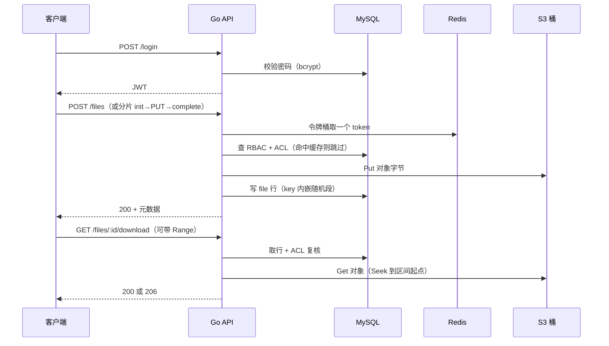

# Go-DocHub


多租户文件安全分发与权限协作系统：分片断点续传、SHA256 秒传、RBAC + ACL 权限、租户级限流、账号与配额管理，字节落在 S3 兼容对象存储。

## 项目预览

```
$ bash scripts/demo-chunked-upload.sh
== login ==
== init (1048576 bytes, sha 48bd31db…) ==
{"code":0,...,"upload_id":15,"chunk_size":1048576,"chunk_count":1}
== status after the simulated interruption ==
{"code":0,...,"done":false,"missing":[0],...}
== send only the missing chunk 0 ==
{"code":0,...,"index":0,"size":1048576,...}
== merge ==
{"code":0,...,"id":171,"size":1048576,"storage":"s3"}
== download and compare ==
original: 48bd31db72d5416cd8c35e543df19b4cfaa59f8984c442191b399cfd2ef287a9
returned: 48bd31db72d5416cd8c35e543df19b4cfaa59f8984c442191b399cfd2ef287a9
OK: byte identical
```

中断后只补缺失的分片，合并结果与源文件逐字节一致。

## 核心功能

### 传输链路

> 大文件不该被一次请求绑住，弱网重连也不该从头再来。

- **分片 + 断点续传**：init 返回 uploadID 与分片数，每片带独立校验和；中断后查 `missing` 只补缺的那几片，100MB 乱序到达也能合并成字节一致的文件。
- **秒传**：客户端先报 SHA256，命中同租户已有对象就直接追加一行引用，零传输零写入。
- **存储 key 与行解耦**：key 内嵌随机段而不是由路径派生，秒传的共享对象不会被「同路径重传」悄悄覆盖。

### 权限体系

> RBAC 管「这类事能不能做」，ACL 管「这份文件归谁看」。

- 目录 ACL 沿路径继承，子目录的显式 deny 覆盖父目录的 allow，且不泄漏到兄弟目录。
- 判定结果按 `(用户, 路径, 动作)` 缓进 Redis；权限变更时按主体失效。
- 授权本身也是接口：`PUT /permissions/acl` 写一行、`DELETE /permissions/acl` 删一行，两者都要求 `perm.manage`，写完立刻失效缓存——撤销即时生效，不必等 TTL。
- 下载、删除、上传、列举、分片会话五类路由全部挂同一个 guard；权限校验失败不会顺带暴露「文件是否存在」。

### 租户运营

> 能开户、能授权、知道还剩多少地方放文件。

- `POST /users` 建账号（密码在服务端 bcrypt，任何响应都不回显哈希）；`GET /users`、`GET /roles` 分页列出本租户的账号与角色。
- `PUT /users/:id/roles/:role_id` 与 `DELETE` 授予/撤销角色，两侧都校验属于同一租户——跨租户的角色 id 会 404，不会把别家的权限搬过来。
- 建账号与授权都要求 `perm.manage`：能登录不等于能开户。
- `GET /usage` 报出 `file_count` / `used_bytes` / `quota_bytes` / `remaining` / `used_percent`；配额按 `SUM(size)` 现算，不维护会漂移的计数字段。超配额的上传与分片 init 都在写字节之前返回 413。

## 系统流程



## 技术栈

| 层次 | 技术 | 用途 |
| :--- | :--- | :--- |
| 语言/框架 | Go 1.27 + Gin 1.10 | HTTP 服务、中间件、统一响应 |
| 元数据 | MySQL 8.0 + sqlx | 租户、用户、文件、权限、配额 |
| 缓存/限流 | Redis 7 + Lua | 权限决策缓存、租户级令牌桶 |
| 对象存储 | S3 兼容桶（Cloudflare R2） | 文件字节；`minio-go` 只说协议，不绑定厂商。`storage.mode=dev` 可退回本地目录，仅供开发 |

## 本地运行

| 依赖 | 版本 | 说明 |
| :--- | :--- | :--- |
| Go | 1.27+ | `make build` 会把缓存固定在仓库内 |
| Docker Compose | 任意近三年版本 | 起 MySQL / Redis |
| S3 兼容桶 | 任意 | Cloudflare R2 / AWS S3 / MinIO 均可，需要一个桶与一对密钥 |

```bash
# 1. 起依赖（MySQL / Redis；对象存储用云桶，不在这里）
make up

# 2. 配置：填 S3 endpoint 与桶名，密钥只走环境变量
cp configs/config.example.yaml configs/config.yaml
export GODOC_S3_ACCESS_KEY=<access-key> GODOC_S3_SECRET_KEY=<secret-key>

# 3. 起服务
make run

# 4. 灌几条示例文档，或跑一遍分片演示
bash scripts/seed-documents.sh
bash scripts/demo-chunked-upload.sh
```

Cloudflare R2 的 `storage.s3` 写法：`endpoint: <account-id>.r2.cloudflarestorage.com`、`use_ssl: true`、`region: auto`。

**没有云桶也能跑起来**：把 `storage.mode` 改成 `dev`（或 `export GODOC_STORAGE_MODE=dev`），文件会落在 `storage.local_root` 指向的本地目录，不需要任何 S3 凭据。启动时服务会打一条 WARN，因为这个模式没有冗余、没有生命周期规则，只适合开发：

```bash
export GODOC_STORAGE_MODE=dev
make run
```

`make test` 需要 MySQL 与 Redis 已就绪；集成套件用 `dev` 那个本地实现，不需要桶也不需要网络。S3 契约测试在设置了 `GODOC_TEST_S3_ENDPOINT` 时才会跑，未设置则跳过——所以 `TestProviderContract` 在任何机器上都至少跑一半。

## 目录结构

```
cmd/server/        服务入口：配置加载、依赖组装、优雅退出
internal/
  auth/            登录、JWT 签发与校验
  tenant/          租户上下文、账号管理与配额
  file/            文件元数据与上传下载主链路
  chunk/           分片、秒传、并发合并
  perm/            RBAC + ACL 继承解析与缓存
  storage/         StorageProvider：S3 兼容桶实现 + 开发用本地实现
  ratelimit/       Redis + Lua 租户级令牌桶
  httpx/           统一响应与错误（唯一横切包）
migrations/        顺序编号 SQL，启动时执行
scripts/           分片演示与种子数据
deployments/       docker-compose：MySQL / Redis（对象存储用云桶）
```
